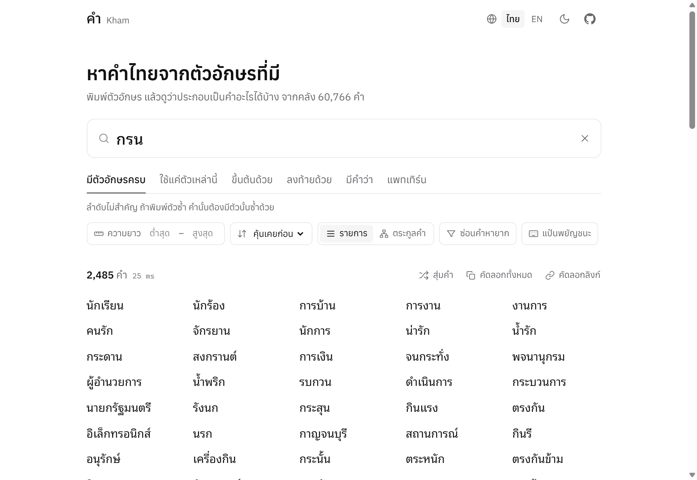

<div align="center">

# Kham · คำ

[](https://github.com/neptunenakub/kham/actions/workflows/test.yml)
[](LICENSE)


**Fast, dependency-free Thai word finder.**
Search 60,000+ Thai words by letters, prefix, suffix, substring or pattern. Results are ranked by how familiar a word is to people, and can be grouped into word families the way a person would think of them.

**ค้นหาคำไทยจากตัวอักษร** · เรียงจากคำที่คนนึกถึงก่อน · จัดกลุ่มเป็นตระกูลคำ · ใช้ได้ทั้งเว็บ, Python และ command line

[**Live demo**](https://neptunenakub.github.io/kham/) · [Python](#python) · [Command line](#command-line) · [How it works](#how-it-works)



</div>

## Features

- **7 search modes**: contains all these letters · uses only these letters · rhymes with · starts with · ends with · contains · pattern (`?` = one character, `*` = any run)
- **Ranked like a person thinks**: familiarity scores from two Thai corpora, so `นักเรียน` comes before `นักธรรม`
- **Word families**: `การ → การบ้าน การงาน การเรียน`, then word play from what was just listed: `การเรียน → เรียน → นักเรียน`
- **Fast**: a per-letter index starts from the rarest letter; typical queries take a few milliseconds
- **Zero dependencies**: pure Python 3.8+ and plain JavaScript; the web demo is static and runs fully in the browser
- **Web demo in Thai and English**, light and dark themes; click a word to copy it and look up its meaning
- **Open data**: word list and frequencies from [PyThaiNLP](https://github.com/PyThaiNLP/pythainlp) (CC0)

Good for word games, chat bots, crossword or poem helpers, autocomplete, and teaching Thai.

## ภาษาไทย (สรุปสั้น)

Kham คือตัวหาคำไทยแบบโอเพนซอร์ส พิมพ์ตัวอักษรที่มี (เช่น `ก ร น`) แล้วได้คำที่มีตัวอักษรครบ เช่น นักเรียน การบ้าน จักรยาน
นอกจากนี้ยังหาคำสัมผัส (เช่น รัก → นัก หนัก ผัก) และค้นแบบ "ใช้แค่ตัวเหล่านี้", ขึ้นต้น, ลงท้าย, มีคำว่า และแพทเทิร์นได้ ผลลัพธ์เรียงตามคำที่คนคุ้นเคย (คำนวณจากคลังข้อความภาษาไทย) และจัดกลุ่มเป็นตระกูลคำได้
ใช้ได้ทั้ง[เว็บ](https://neptunenakub.github.io/kham/) (ไทย/อังกฤษ), ไลบรารี Python, คำสั่งใน terminal และตัวอย่างบอท Discord กับ API ใน `examples/` ไม่ต้องติดตั้งอะไรเพิ่ม

## Python

```bash
pip install git+https://github.com/neptunenakub/kham
```

```python
import kham
from kham import WordFinder

wf = WordFinder()

wf.search(letters="กรน", limit=5)
# ['นักเรียน', 'นักร้อง', 'จักรยาน', 'กระดาน', 'น่ารัก']

wf.search(starts="นัก", sort="long", limit=3)
# ['นักสังคมสงเคราะห์', 'นักประชาสัมพันธ์', 'นักประวัติศาสตร์']

wf.search(pattern="ก?ร")                       # ['การ', 'กรร']
wf.search(letters="กรน", match="only")         # only ก ร น as consonants: การ กัน น้ำ ...
wf.search(ends="ภาพ", min_len=4, max_len=6)
wf.search(letters="กรน", min_familiarity=kham.COMMON)   # hide rare words

wf.search(rhymes="รัก", limit=6)               # same vowel and final sound in the last syllable
# ['นัก', 'สัก', 'มัก', 'รู้จัก', 'หลัก', 'สุนัข']
wf.rhyme_key("เรียน")                          # 'ia:n'

wf.families(wf.search(letters="รก", limit=30))
# [{'stem': 'การ', 'kind': 'new',  'words': ['การ', 'ต้องการ', 'ประการ']},
#  {'stem': 'ประ', 'kind': 'play', 'words': ['ประสบการณ์', 'ประกอบ']},
#  {'stem': 'นัก', 'kind': 'new',  'words': ['นักเรียน']}, ...]
```

### API

| Method | What it does |
|---|---|
| `search(letters, match, starts, ends, contains, pattern, rhymes, min_len, max_len, min_familiarity, sort, limit, exclude)` | Find words. Every filter you pass must hold. `match="all"` (default) needs every letter, repeated letters included; `match="only"` allows only these consonants. `min_familiarity=kham.COMMON` hides rare words (and some real but uncommon ones). `sort` is `familiar`, `long`, `short` or `az`. |
| `families(words, chain=6)` | Group words into families: `[{"stem", "kind", "words"}]`. `kind="play"` marks a jump from a piece of the previous family. |
| `rhyme_key(word)` | The rhyming sound of the last syllable as `vowel:final`: `rhyme_key("รัก") == "a:k"` |
| `parts(word)` | Familiar pieces inside a word: `parts("การเรียน") == (["การ"], ["เรียน"])` |
| `familiarity(word)` | About 0–14; higher means people think of it sooner |
| `is_word(word)` / `word in wf` | Dictionary check |
| `random(n, min_familiarity=6.0, seed=None)` | Random familiar words |

There is also a shortcut: `import kham; kham.search(letters="กรน")`.

## Command line

```bash
kham กรน                      # words containing ก, ร and น
kham กรน --only               # words built only from ก, ร, น
kham --starts นัก --sort long
kham --pattern "ก?ร*" --max 5
kham กรน --common             # hide rare words
kham --rhymes รัก             # words that rhyme with รัก
kham รก --families --json
kham --random 10
```

Without installing, run `python -m kham ...` from the repository folder. `kham --help` lists every option.

## Bots and APIs

Two small examples in [`examples/`](examples/):

- [`api_server.py`](examples/api_server.py): a JSON API using only the standard library. Run `python examples/api_server.py`, then call `GET /search?letters=กรน&limit=10`, `/families?letters=รก` or `/word?w=นักเรียน`. Any chat bot (LINE, Telegram, Discord) can call it from its webhook.
- [`discord_bot.py`](examples/discord_bot.py): a Discord bot with `/kham`, `/khamrhyme`, `/khamstart`, `/khamend` and `/khampattern` slash commands. Needs `pip install discord.py` and your own bot token in the `DISCORD_TOKEN` environment variable.

## Web demo

The demo in [`docs/`](docs/) is a few static files plus the word list. No build step.

```bash
python -m http.server 8000 --directory docs
```

Then open http://localhost:8000. (Opening `index.html` directly does not work, because browsers block `fetch` on `file://`.)

**Publish on GitHub Pages:** Settings → Pages → *Deploy from a branch* → `main` / `/docs`. If you fork this project, change the `REPO` constant at the top of [`docs/app.js`](docs/app.js) to your own repository URL.

The engine is one file with no dependencies, [`docs/kham.js`](docs/kham.js). It works in a browser (`Kham.load(text)`, `Kham.search({ letters: "กรน" })`, `Kham.families(words)`, `Kham.rhymeKey("รัก")`) and in Node (`require("./docs/kham.js")`).

## How it works

1. **Index by letter.** Every character maps to the words that contain it. A query starts from its rarest required letter, so `ฌ` scans a handful of words instead of 60,000.
2. **Familiarity.** Each word gets a score from its frequency in the Thai National Corpus (news, academic) and the Thai Textbook Corpus (everyday text), weighted towards everyday text. Compounds are often split in real text (`การบ้าน` is counted less than `การ` and `บ้าน`), so a compound on a common head such as `การ`, `นัก` or `น้ำ` is pulled halfway towards its weaker piece. Only halfway, because common pieces say little about the compound itself. Hand-picked everyday words and loanwords get a minimum score and a boost, since the corpora miss words like `มือถือ`.
3. **Word pieces.** A word is cut only where a Thai syllable can start: not before a vowel or tone mark, not after a leading vowel (`เ แ โ ใ ไ`), not inside `เ-ีย / เ-ือ / -ัว`, and not before a silenced letter (`การณ์`). Familiar pieces on either side of a cut are what a person "sees" in the word.
4. **Families.** Stems are scored by their best unused word. The best stem forms a family; afterwards, a familiar piece of what was just listed often starts the next one (`สังคม → คม → คมมีด`), just like people do when they brainstorm words.
5. **Rhymes.** Rules read the spelling of the last syllable from the end of the word (silenced letters, leading vowels, clusters, implied vowels) and reduce it to a vowel and a final sound, such as `a:k` for `รัก`. Words with the same key rhyme. There is no pronunciation dictionary, so irregular spellings and a few ambiguous ones come out wrong.

## Project layout

```
kham/                 Python package (finder.py, rhyme.py, thai.py, CLI in __main__.py)
kham/data/lexicon.tsv the built word list the package and the web demo both use
docs/                 web demo (index.html, style.css, app.js) and kham.js, the engine for browsers and Node
data/raw/             source word lists
scripts/build_lexicon.py  rebuilds lexicon.tsv from data/raw
examples/             JSON API server and Discord bot
tests/                unit tests, and a check that kham.js and the Python package agree
```

Rebuild the word list after editing anything in `data/raw/`:

```bash
python scripts/build_lexicon.py
python -m unittest discover -s tests -t .
```

`lexicon.tsv` has one entry per line: `word`, `familiarity` (`-` if it is only a piece, not a dictionary word), `piece score` (`-` if too rare to notice inside other words), and `c` for hand-picked common words.

## Data and credits

- `words_th.txt`, `tnc_freq.txt`, `ttc_freq.txt` from [PyThaiNLP](https://github.com/PyThaiNLP/pythainlp), released under CC0 1.0.
- `common_th.txt` and `loanwords.txt` are hand-picked lists from this project.

## License

[MIT](LICENSE)
